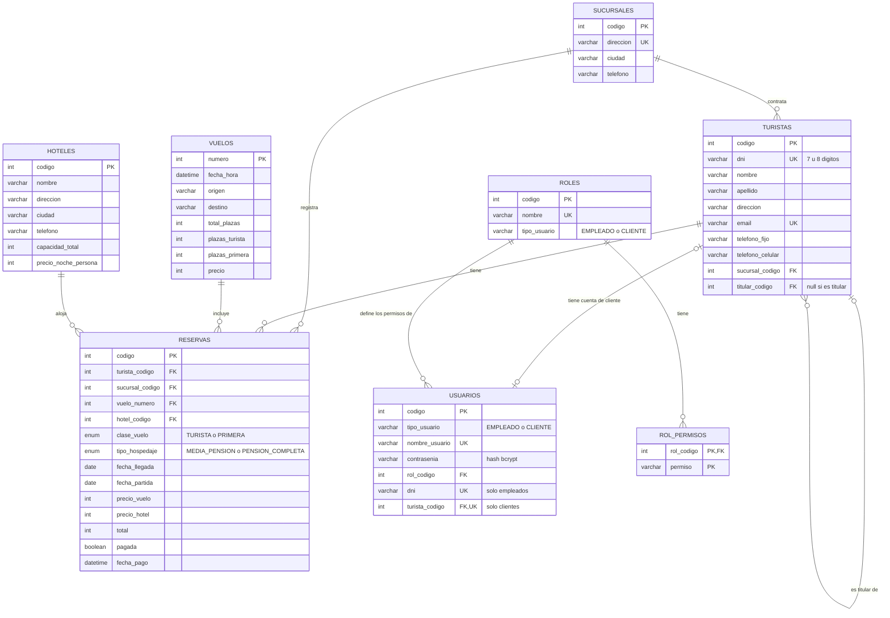

# Modelo entidad-relación de Tije Travel

El esquema se crea con las migraciones de Flyway en
`tije-back/src/main/resources/db/migration` (V1 a V11). El diagrama muestra cómo
quedan las tablas después de aplicar todas las migraciones.

La tabla `control_escrituras` tiene una sola fila y no se relaciona con las
demás: los servicios la bloquean con `SELECT ... FOR UPDATE` para que dos
escrituras no se pisen (`BloqueoEscrituras`).

## Relaciones

| Relación | Cardinalidad | Cómo se implementa |
|---|---|---|
| Sucursal contrata turistas | 1 a N | `turistas.sucursal_codigo` → `sucursales.codigo` |
| Titular y familiares | 1 a N (autorrelación) | `turistas.titular_codigo` → `turistas.codigo`; es null en el titular |
| Turista tiene reservas | 1 a N | `reservas.turista_codigo` → `turistas.codigo` |
| Sucursal registra reservas | 1 a N | `reservas.sucursal_codigo`: guarda la sucursal del momento de la reserva aunque el turista se mude |
| Vuelo y hotel de la reserva | 1 a N cada uno | `reservas.vuelo_numero` y `reservas.hotel_codigo` |
| Cliente y turista titular | 1 a 1 (opcional) | `usuarios.turista_codigo`, único y solo para clientes |

## Herencia de usuarios y roles

En Java, `Usuario` es una clase abstracta con dos subclases: `Empleado` y
`Cliente`. En la base se guardan las dos en la tabla `usuarios` (estrategia
`SINGLE_TABLE`) y la columna `tipo_usuario` indica qué clase es. Los checks de la
tabla aseguran que:

- un cliente siempre tiene `turista_codigo` y nunca un DNI propio (lo toma del turista);
- un empleado nunca tiene `turista_codigo`.

Lo que puede hacer cada usuario depende de su rol (`rol_codigo`). Los permisos
de cada rol están en `rol_permisos`, una fila por permiso tildado. La migración
V11 crea los roles Administrador, Vendedor y Cliente; después se pueden crear
otros, como Hotelero.

## Borrado lógico

Todas las tablas tienen `fecha_creacion` y `fecha_baja`. Dar de baja completa
`fecha_baja` en lugar de borrar la fila, así una reserva vieja sigue mostrando un
hotel que ya no se ofrece. Los datos únicos (DNI, email, nombre de usuario,
dirección de sucursal, etc.) se controlan con columnas generadas `..._activo`
que valen NULL cuando la fila está dada de baja: el índice único admite varios
NULL, entonces una persona dada de baja puede volver a registrarse.

## Restricciones principales

- Un turista no puede tener dos reservas activas en el mismo vuelo (`uk_reserva_turista_vuelo`).
- Un hotel no puede repetirse con el mismo nombre en la misma ciudad (`uk_hotel_nombre_ciudad`).
- La fecha de llegada tiene que ser anterior a la de partida (`chk_reserva_fechas`).
- Las plazas por clase de un vuelo no pueden superar el total (`chk_vuelo_distribucion_plazas`).
- Precios de vuelos entre 150.000 y 300.000 (múltiplos de 10.000) y de hoteles
  entre 25.000 y 55.000 por noche (múltiplos de 1.000).
- `total` de la reserva siempre es `precio_vuelo + precio_hotel` (`chk_reserva_importes`).
