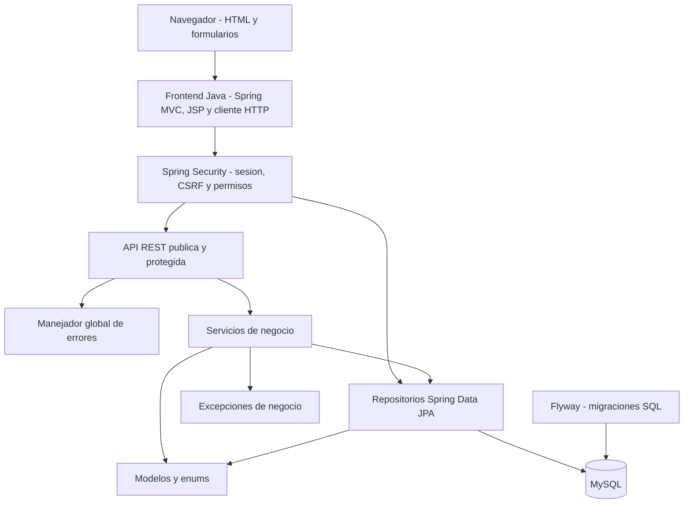
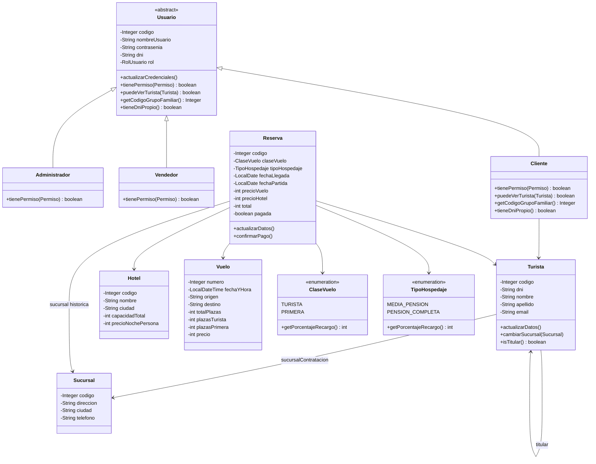
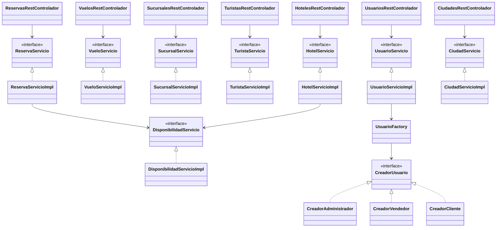
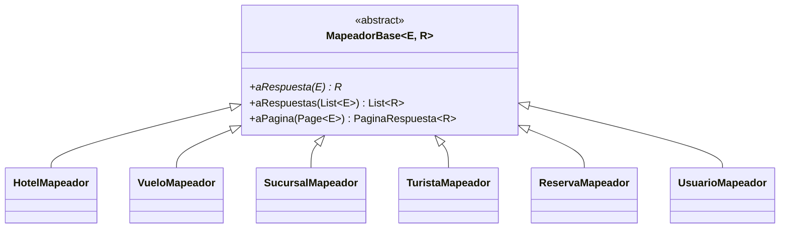

# UML Tije Travel

Este diagrama representa el nucleo de la version web. La version PlantUML se
encuentra en `uml-tijetravel.puml`.

## Capas

## Dominio

Cada subclase de `Usuario` redefine `tienePermiso`. `Cliente` además redefine
`puedeVerTurista` y `getCodigoGrupoFamiliar` para limitarse a su grupo familiar,
así los servicios no preguntan por el rol (polimorfismo).

## Componentes

Los controladores dependen de las interfaces de los servicios y no de sus
implementaciones (principio de inversión de dependencias). Spring inyecta la
clase `...Impl` que corresponde.

### Servicios, repositorios y seguridad

```mermaid
classDiagram
    class JpaRepository {
        <<interface>>
    }
    JpaRepository <|-- SucursalRepositorio
    JpaRepository <|-- HotelRepositorio
    JpaRepository <|-- VueloRepositorio
    JpaRepository <|-- TuristaRepositorio
    JpaRepository <|-- ReservaRepositorio
    JpaRepository <|-- UsuarioRepositorio

    HotelServicioImpl --> HotelRepositorio
    VueloServicioImpl --> VueloRepositorio
    SucursalServicioImpl --> SucursalRepositorio
    TuristaServicioImpl --> TuristaRepositorio
    ReservaServicioImpl --> ReservaRepositorio
    UsuarioServicioImpl --> UsuarioRepositorio
    DisponibilidadServicioImpl --> ReservaRepositorio

    HotelServicioImpl --> AutorizacionServicio
    ReservaServicioImpl --> AutorizacionServicio
    HotelServicioImpl --> BloqueoEscrituras
    ReservaServicioImpl --> BloqueoEscrituras
    HotelServicioImpl --> FiltrosConsulta
    VueloServicioImpl --> ComparadorCercaniaFecha
    DisponibilidadServicioImpl --> OcupacionHotel

    class AuthenticationEntryPoint {
        <<interface>>
    }
    class AccessDeniedHandler {
        <<interface>>
    }
    AuthenticationEntryPoint <|.. EscritorErrorSeguridad
    AccessDeniedHandler <|.. EscritorErrorSeguridad
    ConfiguracionSeguridad --> EscritorErrorSeguridad
    ConfiguracionSeguridad --> UsuarioDetallesServicio
    UsuarioDetallesServicio --> UsuarioRepositorio
    UsuarioActualServicio --> UsuarioRepositorio
```

### Mapeadores (DTO)

`MapeadorBase` aplica el patrón Template Method: cada subclase solo dice cómo
convertir un elemento y la base reutiliza esa conversión para listas y páginas.
